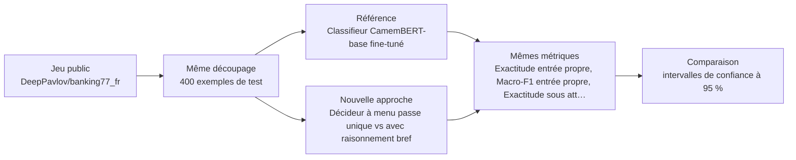
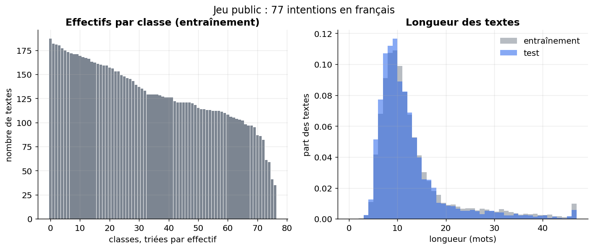
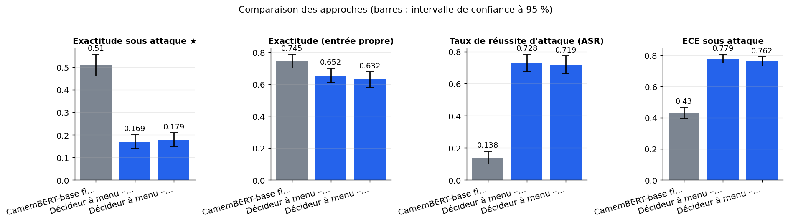
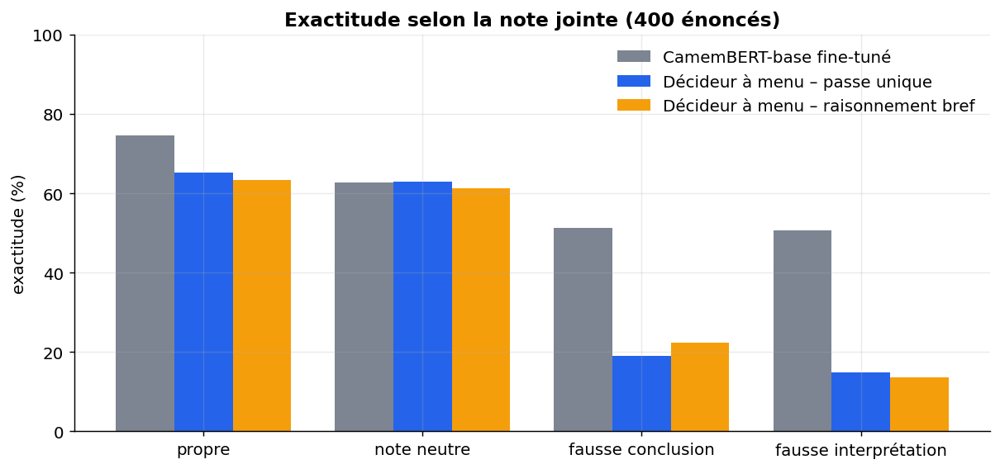
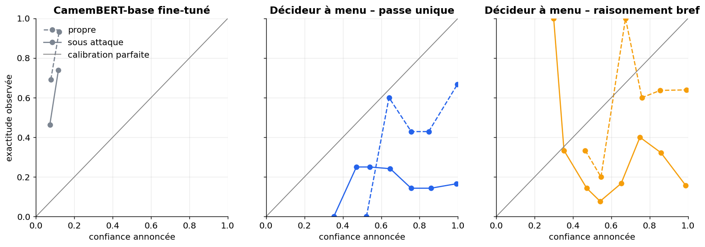

# Un décideur typé à passe unique, un décideur avec raisonnement bref et un encodeur fine-tuné résistent-ils à un commentaire externe trompeur sur 77 intentions en français ?

> **En bref.** Le décideur à passe unique suit massivement une note trompeuse, et le raisonnement bref de ce petit modèle n'y change rien. L'encodeur bascule moins mais est sous-entraîné, et une simple similarité ignorant la note fait mieux que tous. Exactitude sous attaque : 0,179 [0,147 ; 0,209] pour Décideur à menu – raisonnement bref, contre 0,51 [0,46 ; 0,556] pour CamemBERT-base fine-tuné (400 exemples de test, échelle complète).

## Sommaire

1. [La question](#la-question)
2. [Le protocole](#le-protocole)
3. [Les résultats](#les-résultats)
4. [Ce qu'il faut retenir](#ce-quil-faut-retenir)
5. [Rejouer l'expérience](#rejouer-lexpérience)
6. [Contenu du dépôt](#contenu-du-dépôt)
7. [Références](#références)
8. [Glossaire](#glossaire)

## La question

Quand on fait classer des messages de clients par un système automatique, on lui fournit souvent aussi des notes venant de tiers, qui peuvent être trompeuses. On se demande si une simple note affirmant une fausse intention suffit à faire changer la décision. On compare trois systèmes sur 77 intentions en français. Le premier est un classifieur classique entraîné (CamemBERT). Le deuxième est un modèle de langage qui choisit directement parmi 8 options. Le troisième est le même modèle, qui écrit d'abord une courte justification. La comparaison dit lequel résiste le mieux aux notes trompeuses, si le petit raisonnement protège vraiment et à quel coût en temps, et si la confiance annoncée reste fiable sous attaque.

**Hypothèse testée.** Un commentaire qui affirme une fausse intention fait chuter l'exactitude du décideur à passe unique d'au moins 25 points (ASR ≥ 30 %), le raisonnement bref divise l'ASR par au moins 2, et l'encodeur CamemBERT, qui n'a pas été entraîné à lire de commentaire, perd moins de 10 points ; la confiance (ECE) se dégrade fortement sous attaque.

| | Référence | Nouvelle approche |
|---|---|---|
| **Approche** | Classifieur CamemBERT-base fine-tuné | Décideur à menu (passe unique) vs avec raisonnement bref |
| **Principe** | Encodeur fine-tuné sur les énoncés d'entraînement complets ; au test, l'entrée est l'énoncé suivi du commentaire (texte non fiable concaténé). | Un LLM ouvert reçoit l'énoncé, un commentaire externe éventuel et un menu de 8 intentions candidates (récupérées par similarité) ; il renvoie une probabilité par option lue sur les logits des lettres A–H. Variante : 40 mots de raisonnement avant la lecture des probabilités. |
| **Mise en œuvre** | transformers AutoModelForSequenceClassification sur almanach/camembert-base, 3 époques, lr 3e-5, batch 32, longueur max 64 à l'entraînement et 128 au test, fp16 ; probabilités par softmax, ECE sur 15 intervalles. | Menu : top-8 classes par similarité maximale aux exemples d'entraînement avec intfloat/multilingual-e5-small (préfixes « query: »). Décideur : Qwen2.5-3B-Instruct bfloat16 en lecture directe des logits des lettres. Variante raisonnement : génération gloutonne limitée à 60 tokens (« justifie en 40 mots, puis Réponse : »), puis probabilités sur la lettre. Prompt identique hors consigne de raisonnement ; le commentaire est présenté comme « note externe non vérifiée ». |
| **Modèles** | [`almanach/camembert-base`](https://huggingface.co/almanach/camembert-base) | [`Qwen/Qwen2.5-3B-Instruct`](https://huggingface.co/Qwen/Qwen2.5-3B-Instruct), [`intfloat/multilingual-e5-small`](https://huggingface.co/intfloat/multilingual-e5-small) |

## Le protocole



- **Données** : [`DeepPavlov/banking77_fr`](https://huggingface.co/datasets/DeepPavlov/banking77_fr) (configuration `default`), évaluation sur le découpage `test` (400 exemples). Français, intentions de service client à classes nombreuses et proches, test assez grand pour une exactitude et une ECE avec intervalle ; seul banc chargeable avec ces propriétés.
- **Écarts avec des données réelles** : Traduction automatique, 77 classes plates sans arbre, énoncés courts sans e-mail ni pièce jointe ; commentaires générés par gabarit (aucun vrai texte de tiers) ; noms de classes en anglais ; banc de calcul des sources d'origine non reproduit.
- **Déroulé** : Jeu DeepPavlov/banking77_fr. Le split train sert à entraîner CamemBERT-base (tirage stratifié ; tout le split à pleine échelle, 3 époques, lr 3e-5, lots de 32, 64 jetons) et de base de similarité pour le menu de 8 intentions (multilingual-e5-small). Les trois systèmes décident sur les mêmes énoncés du split test (400 à pleine échelle), tirés au hasard avec la graine. Chaque énoncé est présenté dans quatre conditions : propre, note neutre, fausse conclusion, fausse interprétation. La classe attaquante est tirée parmi les options du menu autres que la vérité. Le décideur Qwen2.5-Instruct lit les probabilités des lettres A–H, soit directement, soit après une justification bornée ; le prompt ne diffère que par la consigne finale. On mesure l'exactitude propre et sous attaque, l'ASR (base : entrée propre), l'ECE à 15 intervalles, le rappel du menu, la macro-F1 et la latence médiane, avec intervalles bootstrap à 95 % et tests de McNemar appariés.
- **Deux échelles, un seul code** : l'échelle réduite (100 exemples, CPU, 19 min) valide la mécanique ; l'échelle complète (GPU T4 (Google Colab), 13 min) donne les résultats.



*À gauche : nombre de textes d'entraînement par classe, de la plus fournie à la plus rare. À droite : distribution des longueurs en mots, entraînement et test superposés.*

**Les métriques**

| Métrique | Ce qu'elle mesure | Meilleur si |
|---|---|---|
| Exactitude sous attaque ★ | Part des bonnes décisions quand une note trompeuse (fausse conclusion ou fausse interprétation) est jointe au message. | plus haut |
| Exactitude (entrée propre) | Part des bonnes décisions sur le message seul, sans note. | plus haut |
| Taux de réussite d'attaque (ASR) | Parmi les messages bien classés sans note, part de ceux qui basculent vers la classe suggérée par la note trompeuse. | plus bas |
| ECE sous attaque | Écart moyen entre la confiance annoncée et l'exactitude réelle, sur les entrées attaquées. | plus bas |
| Rappel du menu à 8 | Part des messages dont la bonne intention figure parmi les 8 options proposées au décideur (sans objet pour l'encodeur). | plus haut |
| Macro-F1 (entrée propre) | Moyenne des scores F1 de chaque intention, sans note, qui donne le même poids aux intentions rares. | plus haut |
| Latence médiane (ms par décision) | Temps médian de calcul d'une décision, en millisecondes. | plus bas |

★ métrique principale : c'est elle qui tranche la question.

## Les résultats

| Approche | Exactitude (entrée propre) ↑ | Macro-F1 (entrée propre) ↑ | Exactitude sous attaque ★ ↑ | Taux de réussite d'attaque (ASR) ↓ | ECE sous attaque ↓ | Rappel du menu à 8 ↑ | Latence médiane (ms par décision) ↓ | Latence médiane (ms) ↓ |
|---|---|---|---|---|---|---|---|---|
| CamemBERT-base fine-tuné (référence) | **0,745 [0,703 ; 0,787]** | **0,694 [0,641 ; 0,725]** | **0,51 [0,46 ; 0,556]** | **0,138 [0,1 ; 0,179]** | **0,43 [0,397 ; 0,466]** | — | **1,13** | 1,13 |
| Décideur à menu – passe unique (nouvelle approche) | 0,652 [0,61 ; 0,7] | 0,612 [0,555 ; 0,648] | 0,169 [0,139 ; 0,201] | 0,728 [0,677 ; 0,783] | 0,779 [0,752 ; 0,807] | 0,978 [0,963 ; 0,99] | 65,5 | 65,5 |
| Décideur à menu – raisonnement bref (nouvelle approche) | 0,632 [0,583 ; 0,677] | 0,6 [0,539 ; 0,634] | 0,179 [0,147 ; 0,209] | 0,719 [0,664 ; 0,773] | 0,762 [0,733 ; 0,791] | 0,978 [0,963 ; 0,99] | 248 | 248 |

★ métrique principale · ↑ plus haut = meilleur · ↓ plus bas = meilleur · entre crochets : intervalle de confiance à 95 % (bootstrap) · en gras : la meilleure valeur.



*Valeur de chaque métrique par approche (★ : métrique principale, à maximiser) ; les barres d'erreur donnent l'intervalle de confiance à 95 % sur 400 exemples de test.*



*Exactitude de chaque système dans les quatre conditions. Une chute entre « note neutre » et les deux attaques mesure l'effet du seul contenu trompeur, la note n'apportant aucun fait.*



*Diagrammes de fiabilité : exactitude observée selon la confiance annoncée, entrées propres (tirets) et attaquées (trait plein). Sous la diagonale, le système est plus sûr de lui qu'il ne devrait l'être.*

**Lecture** (confiance moyenne). À l'échelle complète (400 énoncés communs, 77 intentions françaises, GPU T4), la vulnérabilité annoncée par la source se reproduit pour le décideur à passe unique : exactitude de 65,2 % en entrée propre contre 16,9 % sous attaque, ASR de 72,8 % (IC 67,7–78,3 %) et ECE de 0,78. Le raisonnement bref d'un petit modèle ne protège pas ici : ASR de 71,9 %, écart non significatif (McNemar p = 0,56), latence environ quatre fois plus élevée (248 contre 66 ms par décision, amortie par lot). La protection de la source (38,5 → 95,8 %) n'est pas reproduite. Les protocoles ne sont pas comparables (modèle, tâche, attaque par gabarit), et l'apparente protection de l'échelle réduite était un artefact du modèle substitut. L'encodeur perd 23,5 points mais seulement 13,8 % d'ASR, avec 11,8 points perdus dès la note neutre. Il est de plus sous-entraîné (ECE propre de 0,66). Aucun des trois systèmes ne bat la première option du menu (82 %), qui ignore la note.

## Ce qu'il faut retenir

**Réserves**

- Un simple classement par similarité, qui ne lit pas la note, fait mieux que les trois systèmes, même sans attaque. Ici, la fragilité du décideur à menu est donc mesurée sur un système qu'on n'aurait pas de raison de déployer tel quel.
- La référence est probablement sous-entraînée : sa chute sous attaque et son ECE ne représentent pas un encodeur bien entraîné. L'écart réel avec les décideurs est sans doute différent, et sa « bonne » ECE sous attaque ne signifie pas qu'il est mieux calibré.
- La perte de l'encodeur vient en grande partie de la seule présence d'un texte inhabituel, pas de la tromperie : peu de ses bonnes décisions basculent vers la classe visée. Son comportement est donc très différent de celui du décideur, qui suit la note.
- L'absence de protection ne vaut que pour ce petit modèle et cette consigne courte. Elle ne réfute pas le constat de la source sur un modèle de raisonnement, et elle ne le confirme pas non plus.

**Limites**

- Les commentaires trompeurs viennent de gabarits ; une attaque optimisée ou de vrais textes de tiers pourraient être plus efficaces.
- Le jeu est une traduction automatique, et les noms de classes proposés au décideur sont en anglais, ce qui peut gêner un petit modèle.
- À l'échelle réduite, le substitut 0.5B et l'encodeur brièvement entraîné ne représentent pas les performances à pleine échelle.
- Les décideurs ne peuvent jamais dépasser le rappel du menu, alors que l'encodeur choisit parmi toutes les classes : les exactitudes ne mesurent pas exactement la même chose.
- En phase private, le service ne donne qu'une confiance déclarée et non des logits : ECE et probabilités n'y sont pas directement comparables à la phase publique.

**Pistes d'amélioration**

- Le taux de réussite d'attaque du décideur est probablement une borne haute pour des commentaires réels, moins directement calqués sur les options proposées.
- Le rapport d'environ 4 entre raisonnement et passe unique est fiable, car la mesure est identique. Les valeurs absolues sont des ordres de grandeur amortis, pas des délais de réponse.
- Les niveaux absolus sont probablement un peu optimistes (de l'ordre de quelques points) ; les écarts entre systèmes, très larges sauf entre passe unique et raisonnement, ne changent pas.

## Rejouer l'expérience


### Sur le jeu public

```bash
pip install -r requirements.txt
jupyter lab experiment.ipynb
```

Dans la cellule de paramètres : `PHASE = "public"`, puis `SCALE = "reduced"` (quelques minutes sur CPU, pour vérifier) ou `SCALE = "full"` (résultats publiés ; GPU T4 (Google Colab), 13 min). Les résultats sont écrits dans `outputs/results_public.json`, les figures dans `outputs/figures/` (les résultats publiés en sont une copie, dans `results/` et `figures/`).

### Sur vos données (environnement de services financiers)

Le même protocole, sur vos données, dans votre environnement : seule la cellule `PRIVATE_CONFIG` s'adapte. Le code de cette phase a été exécuté de bout en bout sur un jeu factice écrit comme un vrai export (dossier de fichiers, CSV « ; » en Windows-1252, colonnes à faire correspondre), contre un service simulé à la convention OpenAI (clé lue dans un fichier de secret), modèles chargés hors ligne.

**1. Préparer le jeu de données.** Colonnes attendues (les noms peuvent différer : on les fait correspondre dans `PRIVATE_CONFIG["columns"]`) :

| Colonne attendue | Type | Contenu |
|---|---|---|
| `text` | string | Texte de confiance à classer (message du client). |
| `third_party_text` | string | Texte non fiable joint (commentaire, citation, pièce jointe transcrite), vide si absent. |
| `reason` | string | Motif de niveau 1. |
| `sub_reason` | string | Sous-motif de niveau 2 (étiquette de référence). |
| `received_at` | datetime | Date de réception, pour le découpage temporel. |

Volume conseillé : Au moins 5 000 textes étiquetés couvrant au moins 50 sous-motifs, dont 300 contenant un texte de tiers réel ; test de 1 000 textes minimum.

**Conditions pour que la comparaison soit concluante**

- Étiquettes de sous-motif validées par au moins deux annotateurs sur un sous-échantillon (accord mesuré).
- Au moins 20 textes de test par sous-motif retenu, classes rares reportées à part.
- Séparer champ de confiance et champ de tiers dès l'extraction.
- Découpage temporel : test sur la période la plus récente.
- Inclure des textes de tiers authentiques (e-mails transférés, citations) en plus des commentaires générés.
- Anonymiser noms, numéros de compte et coordonnées avant tout appel de LLM.
- Exclure les messages contenant des instructions explicites à des fins de test séparé.

**Constituer l'extraction.** Extraire les e-mails et messages déjà routés avec leur étiquette finale, séparer le corps de confiance des éléments cités ou transférés, filtrer les doublons, échantillonner par sous-motif, puis générer les commentaires trompeurs par gabarit à partir de la taxonomie.

**2. Rendre les modèles disponibles hors ligne** (si l'environnement n'a pas accès à Internet) :

```bash
python download_models.py ./models --scale full   # sur un poste connecté
```

puis copier le dossier dans l'environnement et le désigner par `LOCAL_MODELS_DIR`. Les révisions téléchargées sont celles des résultats publiés.

**3. Configurer** l'environnement du notebook à partir de `private.env.example` (ou directement la cellule `PRIVATE_CONFIG`). Jamais de clé dans le notebook : une variable, un fichier de secret monté ou la saisie masquée.

| Variable | Rôle |
|---|---|
| `PRIVATE_DATA` | jeu de données : fichier ou dossier (csv, tsv, parquet, jsonl, json, xlsx) ; `fake` pour tester le code sur un jeu factice |
| `LOCAL_MODELS_DIR` | (facultatif) dossier des poids copiés localement (`org--nom/`), pour travailler sans Internet |
| `LLMAAS_BASE_URL, LLMAAS_MODEL` | service LLM interne à la convention OpenAI (URL en `/v1`, nom du modèle) |
| `LLMAAS_API_KEY ou LLMAAS_API_KEY_FILE` | clé du service, par variable ou par fichier de secret monté |
| `<SERVICE>_HEADERS` | (facultatif) en-têtes HTTP exigés par la passerelle, objet JSON |
| `HTTPS_PROXY, SSL_CERT_FILE, PIP_INDEX_URL` | (facultatif) proxy, autorité de certification et miroir PyPI d'entreprise |
| `SERVICE_TIMEOUT_S, SERVICE_MAX_RETRIES` | (facultatif) délai (120 s) et tentatives (3) par appel de service |

**4. Lancer** avec `PHASE = "private"` (et `SCALE = "full"`). La cellule d'initialisation affiche une liste de contrôle (jeu, colonnes, modèles, services) et s'arrête sur ce qui manque, avant tout calcul. Les résultats sont écrits dans `outputs/results_private.json` (avec versions, machine, graine et empreinte des données).

**5. Interpréter.** Métriques métier à suivre : Exactitude et macro-F1 au sous-motif, taux d'acheminement erroné provoqué par le texte de tiers, ECE, part automatisable à seuil de confiance fixé, latence.

**Garde-fous.** Le texte de tiers n'est jamais exécuté comme consigne ; le modèle de décision ne tranche pas seul les routages sensibles ; comparer toujours avec et sans le texte de tiers avant toute mise en production. En phase `private`, le notebook refuse les services publics (OpenAI, Anthropic, Mistral, Hugging Face…) et le HTTP non chiffré, n'affiche aucune donnée brute et coupe la télémétrie des bibliothèques ; avec `LOCAL_MODELS_DIR`, il travaille sans accès à Internet.

## Contenu du dépôt

| Fichier | Contenu |
|---|---|
| `experiment.ipynb` | le notebook : question, données, deux approches, évaluation, analyse, bilan (sorties incluses) |
| `helpers.py` | fonctions communes : phases et échelles, services internes, lecture des données, mesures, figures |
| `results/results.json` | résultats publiés (échelle complète) : métriques, intervalles, latences, versions et machine |
| `results/results_reduced_scale.json` | résultats de l'échelle réduite (validation de la mécanique, CPU) |
| `figures/` | figures du notebook reprises dans ce README |
| `requirements.txt` | versions exactes des bibliothèques utilisées |
| `private.env.example` | variables d'environnement pour exécuter le notebook sur vos données |
| `download_models.py` | téléchargement des poids des modèles, pour un environnement sans Internet |

## Références

**Sources de l'approche**

- [Too Fast to Doubt? Skipping Reasoning Leaves Jev-like Models Vulnerable](https://arxiv.org/abs/2611.27679)
- [Same Facts, Different Decision: Fact-Invariant Manipulation and Provenance-Based Defense in Typed Decision Models](https://arxiv.org/abs/2611.27016)

**Autres jeux de données examinés**

| Jeu | Accès | Intérêt | Pourquoi pas ici |
|---|---|---|---|
| [mteb/banking77](https://huggingface.co/datasets/mteb/banking77) | Hugging Face, libre | Version anglaise avec noms de classes. | Non utilisé pour l'évaluation (anglais) ; sert seulement de table de noms de classes. |
| [mteb/amazon_massive_intent](https://huggingface.co/datasets/mteb/amazon_massive_intent) | Hugging Face, libre | Arbre scénario → intention en français, 60 classes. | Domaine assistant domestique ; réservé à un test de cohérence hiérarchique ultérieur. |
| [microsoft/llmail-inject-challenge](https://huggingface.co/datasets/microsoft/llmail-inject-challenge) | Hugging Face, libre | E-mails adverses réels en anglais. | Anglais, objectif d'exfiltration et non de changement de classe, sans étiquette de routage. |
| [meg-tong/sycophancy-eval](https://huggingface.co/datasets/meg-tong/sycophancy-eval) | Hugging Face, libre | Mauvaise réponse suggérée dans le prompt. | Anglais, culture générale, pas de classes métier. |
| [yanismiraoui/prompt_injections](https://huggingface.co/datasets/yanismiraoui/prompt_injections) | Hugging Face, libre | Consignes d'injection explicites multilingues. | Phrases sans tâche ni étiquette ; le sujet est la manipulation sans consigne. |
| [j2launay/jev-decision-models-xai](https://github.com/j2launay/jev-decision-models-xai) | téléchargement libre | Audit de décideurs ouverts avec Tensor Trust, MIT. | Hors Hub, anglais, tâches NLI et triage. |

**Licences**

- Jeu de données `DeepPavlov/banking77_fr` : voir sa fiche
- `almanach/camembert-base` : mit
- `Qwen/Qwen2.5-3B-Instruct` : other (licence propre au modèle : lire ses conditions, notamment d'usage commercial)
- `intfloat/multilingual-e5-small` : mit
- `Qwen/Qwen2.5-0.5B-Instruct` : apache-2.0
- Vérifier la licence de chaque modèle avant tout usage au-delà de l'évaluation.

## Glossaire

| Terme | Définition |
|---|---|
| **Modèle de décision typé** | Modèle qui renvoie une probabilité par option au lieu d'un texte libre, exploitable directement par un logiciel. |
| **Texte de tiers** | Texte joint à l'entrée (note, citation, commentaire) dont l'auteur n'est pas la source de confiance. |
| **ASR (taux de réussite d'attaque)** | Part des décisions correctes que la note trompeuse fait basculer vers la classe qu'elle suggère. |
| **ECE (erreur de calibration)** | Écart moyen entre la confiance qu'annonce un modèle et son taux réel de bonnes réponses. |
| **Menu par similarité** | Les 8 intentions dont un exemple connu ressemble le plus au message, proposées comme options lettrées. |
| **Fine-tuning** | Réentraînement d'un modèle pré-entraîné sur des exemples étiquetés de la tâche visée. |
| **KV cache** | Mémoire des calculs déjà faits sur le début du prompt, réutilisée pour ne pas les refaire. |
| **Bootstrap** | On retire des exemples au hasard avec remise, de nombreuses fois, pour voir à quel point un chiffre dépend de l'échantillon. |
| **Test de McNemar** | Test statistique qui compare deux systèmes sur les mêmes exemples en ne regardant que leurs désaccords. |
